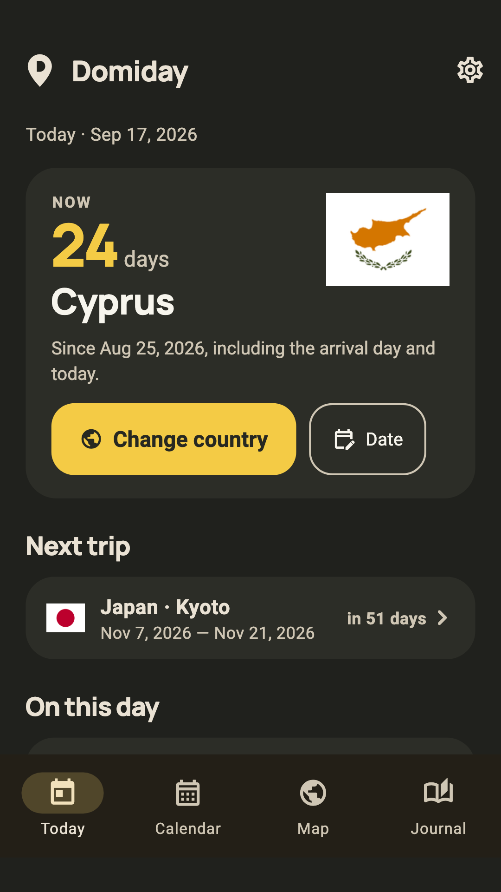
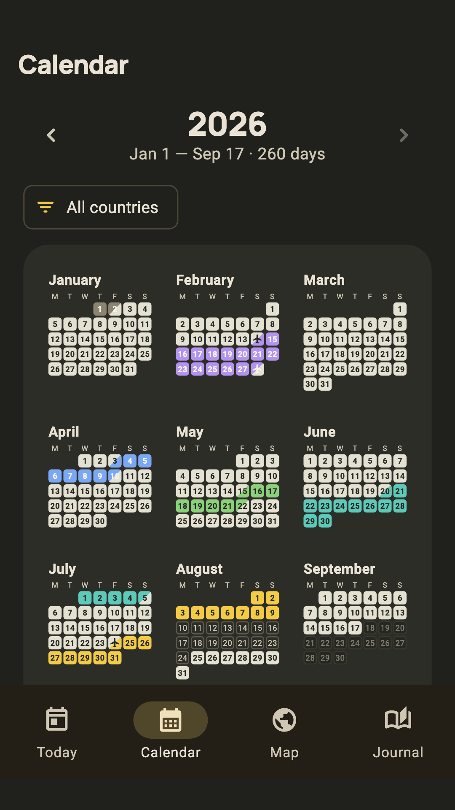
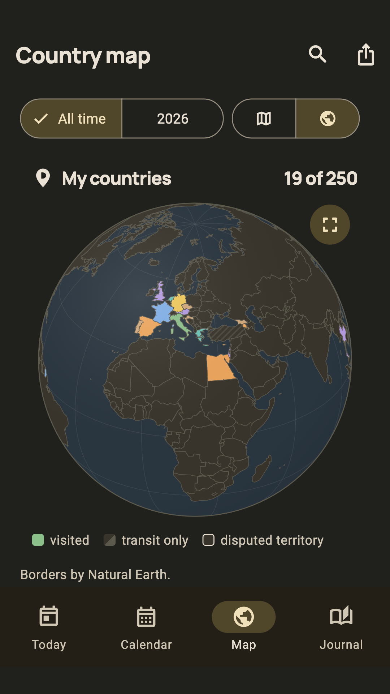
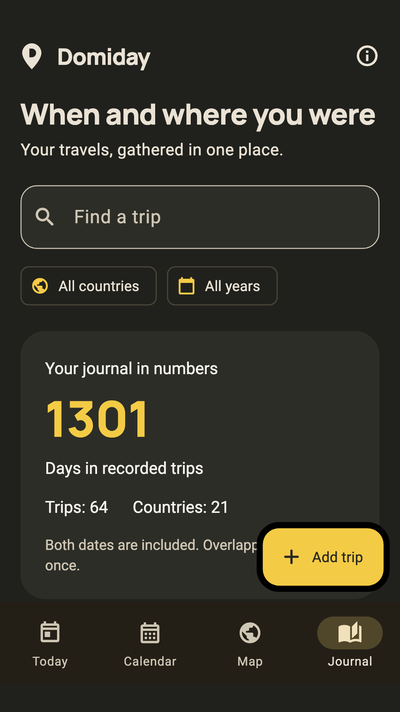

# Domiday — travel days counter for Android

Domiday is a private journal of your trips that counts how many days you have
spent in each country. Your trips appear on a year calendar and on a rotating
globe. Everything stays on your phone: **no account, no server, no internet
access, no ads, no analytics.**

I built it for my own use, and also as an experiment in what can be built
together with AI. It is free, and the source code is open under GPL-3.0.

<p>
  
  
  
  
</p>

## Features

- **Today:** days in the current country, “On this day” in past years, the
  year in four tiles, the next planned trip.
- **Year calendar:** every day painted in its country colour; transit days and
  days in two countries are marked; filter by country.
- **Map and globe:** visited countries on a flat map or a rotating globe, both
  fully offline, with country search.
- **Journal:** trips by year with flags, cities and notes; search by any
  spelling of a country; a page for every country.
- **Trip plans:** future dates are shown but never counted until you confirm
  the trip.
- **Year in review** with a picture you can share.
- **Google Maps Timeline import:** countries are matched offline; you choose
  which periods to add.
- **Country detection** from approximate location, matched against borders
  stored in the app. It is only a suggestion you confirm; coordinates are never
  saved. Background checks are off by default.
- Backup to a single file, English and Russian, light and dark themes.

**Counting rules:** arrival and departure days both count; overlapping days
count once; a moving day belongs to both countries; unknown days are not home
days. Domiday records facts. It does not determine residency, visa or tax
status.

## Privacy

The app has **no `INTERNET` permission**, so it cannot send anything anywhere.
Permissions it does use:

| Permission | Why |
|---|---|
| `ACCESS_COARSE_LOCATION` | Suggest the current country (approximate only) |
| `ACCESS_BACKGROUND_LOCATION` | Optional background check, off by default |
| `POST_NOTIFICATIONS` | “Looks like you are in …” from the background check |
| `WAKE_LOCK`, `RECEIVE_BOOT_COMPLETED`, `ACCESS_NETWORK_STATE` | Scheduling background checks (WorkManager); network state is used only as a trigger, there is no network access |
| `VIBRATE` | Notification vibration (added by the notifications plugin) |

Android backup and device transfer are disabled for the journal
(`allowBackup="false"`); you make backups yourself as a file.

## Download

- **APK:** [Releases](../../releases) or [domiday.com](https://domiday.com).
  Android 7.0+, 64-bit ARM (arm64-v8a) only.
- **Google Play:** in closed testing. Want to help? Sign up at
  [domiday.com/#testers](https://domiday.com/#testers). Google requires at
  least 12 testers for 14 days before an app can be published.

## Building

Flutter 3.47.4, Dart 3.13.3.

```sh
flutter pub get
flutter analyze
flutter test        # 215 tests, including golden screenshots made on macOS
flutter build apk --debug
```

Release builds are signed with the developer's key, which is **not** in this
repository. A release build reads `android/key.properties` (see
`android/key.properties.example`) and fails on purpose without it, so that an
APK signed with another key is never mistaken for an update. To make your own
release build, create your own keystore and `key.properties`.

## Project structure

- `lib/` — the app (UI, counting rules, import, backup, map and globe).
  The globe (`lib/globe.dart`) is drawn with Flutter’s `CustomPainter` and an
  orthographic projection, without map libraries or network tiles.
- `assets/` — country borders, country names, flags, fonts.
- `test/` — unit, widget and golden tests.
- `tool/` — scripts that generate borders, flags, icons and the demo journal.
- `fastlane/metadata/android/` — store descriptions, icon and screenshots
  (used by F-Droid-compatible catalogues such as IzzyOnDroid).
- `demo/domiday-demo-backup.json` — a fictional journal you can restore in the
  app to look around.
- `CLAUDE.md`, `HANDOFF.md`, `START-HERE.md`, `README.ru.md` — the working
  notes and rules used while building the app with AI (in Russian).

## Third-party data and assets

- Country borders: [Natural Earth](https://www.naturalearthdata.com/) 1:50m,
  public domain. Disputed territories are shown as disputed and assigned to no
  one.
- Flags: [flag-icons](https://github.com/lipis/flag-icons), MIT
  (`assets/flags/LICENSE-flag-icons.txt`).
- Font: Manrope, SIL Open Font License (`assets/fonts/OFL-Manrope.txt`).
- Test font: Roboto, Apache 2.0 (`test/fonts/LICENSE.txt`).
- Flutter packages: path_provider, intl, geolocator, workmanager,
  flutter_local_notifications, file_picker (see `pubspec.yaml`).

## License

Copyright © 2026 Domiday.

This program is free software: you can redistribute it and/or modify it under
the terms of the GNU General Public License version 3 as published by the Free
Software Foundation. See [LICENSE](LICENSE).

Contact: [info@domiday.com](mailto:info@domiday.com) ·
[domiday.com](https://domiday.com)
